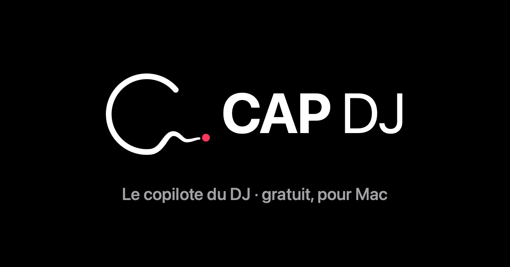

# CAP DJ — le copilote du DJ

**Par DJ Cap Niice · gratuit · version bêta**

CapDJ est une app pour Mac qui fonctionne à côté de Serato DJ Pro.

- **Le prochain morceau.** CapDJ propose la suite à partir de votre bibliothèque, de vos bacs et de vos habitudes de soirée.
- **Sur la platine en un clic.** Les boutons 1 et 2 chargent le morceau directement sur la platine de Serato.
- **À découvrir.** Des titres Apple Music jamais joués, proposés à part.
- **Points Cue.** Des Cue placés selon la structure du morceau. Vous les écoutez, les calez à l'oreille et les validez, un par un ou par dossier entier.

## Télécharger

👉 **[Télécharger CapDJ pour Mac](https://github.com/djcapniice/capdj/releases/latest/download/CapDJ.dmg)**

Il faut un Mac sous macOS 14 ou plus récent (Apple Silicon ou Intel) et Serato DJ Pro 4.

## Installation

1. Ouvrez `CapDJ.dmg` et glissez CapDJ dans le dossier Applications.
2. Ouvrez CapDJ. macOS indique qu'il ne peut pas vérifier l'app : cliquez sur « Terminé ».
3. Allez dans **Réglages Système › Confidentialité et sécurité**. En bas, à côté de « CapDJ a été bloqué », cliquez sur **« Ouvrir quand même »**. Cette étape ne se fait qu'une fois.
4. Dans CapDJ, cliquez sur « Autoriser », puis activez CapDJ dans **Confidentialité et sécurité › Accessibilité**. C'est ce qui permet de charger les morceaux sur les platines.

CapDJ n'est pas encore signé par Apple, d'où l'étape « Ouvrir quand même ».

---

CapDJ © 2026 DJ Cap Niice. Gratuit pour un usage personnel.
CapDJ est un outil indépendant, compatible Serato DJ Pro. Il n'est ni affilié à Serato ni approuvé par Serato. Serato est une marque de Serato Limited.
